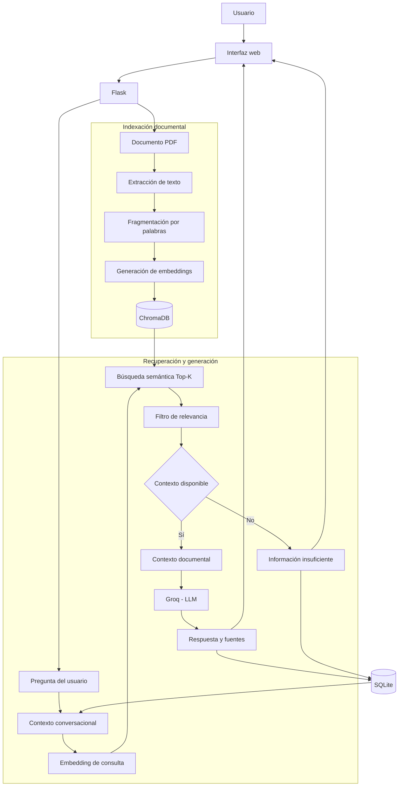

# 🎓 EduRAG — Asistente académico inteligente


## 📖 Descripción

**EduRAG** es un asistente académico inteligente basado en la arquitectura
Retrieval-Augmented Generation (RAG), desarrollado para facilitar la
consulta, comprensión y análisis de documentos PDF mediante inteligencia
artificial.

El sistema combina procesamiento de lenguaje natural, búsqueda semántica,
bases de datos vectoriales y modelos de lenguaje de gran tamaño (LLM)
para generar respuestas contextualizadas a partir de los documentos
proporcionados por el usuario.

A diferencia de un chatbot convencional, EduRAG recupera información
documental antes de generar una respuesta, buscando reducir las
alucinaciones y mejorar la trazabilidad mediante la identificación
de los documentos y páginas consultados.

## 🎯 Problemática y objetivo

Los estudiantes y profesionales deben consultar frecuentemente documentos
académicos extensos, lo que dificulta la identificación de información
relevante y aumenta el tiempo necesario para comprender determinados
conceptos.

EduRAG busca abordar esta problemática mediante un asistente que permita
interactuar con documentos académicos utilizando preguntas en lenguaje
natural y respuestas respaldadas por contexto documental.

### Objetivos específicos

- Implementar la extracción y fragmentación de documentos PDF.
- Generar representaciones vectoriales mediante modelos de embeddings.
- Recuperar información mediante búsqueda semántica.
- Integrar modelos de lenguaje para generar respuestas contextualizadas.
- Identificar los documentos y páginas recuperados.
- Implementar un historial persistente de conversaciones.
- Evaluar el rendimiento del mecanismo de recuperación de información.

## ✨ Funcionalidades

- Carga y procesamiento de documentos PDF.
- Extracción de texto por páginas.
- Fragmentación automática con solapamiento.
- Generación de embeddings multilingües.
- Almacenamiento vectorial persistente.
- Búsqueda semántica mediante distancia coseno.
- Filtrado de resultados mediante un umbral de relevancia.
- Generación de respuestas mediante modelos de lenguaje.
- Selección automática de modelos alternativos de Groq.
- Identificación de documentos y páginas consultados.
- Creación y eliminación de conversaciones.
- Historial persistente de mensajes.
- Comprensión de preguntas de seguimiento.
- Visualización de respuestas en formato Markdown.
- Manejo de errores y validación de documentos.
- Evaluación cuantitativa de la recuperación de información.

## 🏗️ Arquitectura del sistema

EduRAG implementa una arquitectura RAG dividida en dos procesos
principales: indexación documental y recuperación aumentada por generación.



### 1. Indexación documental

1. El usuario carga un documento PDF.
2. El sistema extrae el texto de cada página mediante pypdf.
3. El texto se divide en fragmentos con solapamiento.
4. Sentence Transformers genera los embeddings de cada fragmento.
5. ChromaDB almacena los vectores junto con sus metadatos.

Los metadatos incluyen el nombre del documento, identificador,
número de página y número de fragmento.

### 2. Recuperación y generación

1. El usuario formula una pregunta en lenguaje natural.
2. El sistema incorpora información del historial reciente.
3. Se genera una representación vectorial de la consulta.
4. ChromaDB recupera los fragmentos semánticamente más cercanos.
5. Se aplica un umbral de distancia para filtrar los resultados.
6. Los fragmentos recuperados se incorporan al contexto del LLM.
7. El modelo genera una respuesta basada en el contexto documental.
8. La interfaz presenta la respuesta y las fuentes recuperadas.
9. La conversación se almacena en SQLite.

Cuando no se recupera contexto documental, el sistema informa
al usuario que no encontró información relacionada.

## 🛠️ Tecnologías utilizadas

| Tecnología | Propósito |
|---|---|
| Python | Lenguaje principal de desarrollo |
| Flask | Framework web y lógica del servidor |
| HTML, CSS y JavaScript | Interfaz de usuario |
| Jinja2 | Renderizado de plantillas HTML |
| pypdf | Extracción de texto de documentos PDF |
| Sentence Transformers | Generación de embeddings |
| ChromaDB | Almacenamiento y recuperación vectorial |
| Groq | Servicio de inferencia de modelos de lenguaje |
| SQLite | Persistencia de conversaciones |
| Flask-SQLAlchemy | Gestión de la base de datos relacional |
| python-dotenv | Gestión de variables de entorno |
| Git y GitHub | Control de versiones y trabajo colaborativo |

## ⚙️ Configuración del sistema RAG

| Parámetro | Valor |
|---|---|
| Modelo de embeddings | paraphrase-multilingual-MiniLM-L12-v2 |
| Dimensión de embeddings | 384 |
| Tamaño de fragmento | 200 palabras |
| Solapamiento | 40 palabras |
| Porcentaje de solapamiento | 20 % |
| Tamaño mínimo del fragmento | 15 palabras |
| Métrica configurada | Distancia coseno |
| Top-K | 4 |
| Umbral máximo de distancia | 0.75 |
| Normalización de embeddings | Activada |
| Colección vectorial | edurag_chunks |
| Modelo de lenguaje preferido | openai/gpt-oss-20b |
| Temperatura | 0.1 |
| Máximo de tokens de generación | 1200 |
| Historial reciente | Hasta 6 mensajes |
| Preguntas anteriores para recuperación | Hasta 2 |
| Contexto máximo por fragmento | 1200 caracteres |
| Tamaño máximo de carga | 20 MB |

### Modelos de lenguaje

EduRAG consulta los modelos disponibles mediante la API de Groq
y prioriza los siguientes:

1. `openai/gpt-oss-20b`
2. `llama-3.3-70b-versatile`
3. `llama-3.1-8b-instant`
4. `openai/gpt-oss-120b`

Si un modelo no puede completar una consulta, el sistema intenta
generar la respuesta utilizando otros modelos candidatos.

La disponibilidad de los modelos depende del servicio de Groq.

## 📂 Estructura del proyecto

```text
EduRAG/
├── backend/
│   ├── answer_generator.py
│   ├── document_processor.py
│   ├── evaluation.py
│   ├── run_evaluation.py
│   └── vector_database.py
├── templates/
│   ├── chat.html
│   └── index.html
├── chroma_db/             # Generado localmente
├── instance/              # Generado localmente
│   └── chats.db
├── uploads/               # Generado localmente
├── .env                   # Configuración privada
├── .env.example
├── .gitignore
├── app.py
├── requirements.txt
├── test_search.py
└── README.md
```

### Componentes principales

| Archivo | Responsabilidad |
|---|---|
| app.py | Aplicación Flask, rutas y gestión de conversaciones |
| document_processor.py | Extracción de texto por páginas |
| vector_database.py | Fragmentación, embeddings, indexación y búsqueda |
| answer_generator.py | Construcción del contexto y generación de respuestas |
| evaluation.py | Implementación de métricas de recuperación |
| run_evaluation.py | Conjunto de preguntas y ejecución de la evaluación |
| test_search.py | Prueba interactiva de búsqueda semántica |
| index.html | Interfaz de carga de documentos |
| chat.html | Interfaz conversacional |

## 🚀 Instalación y ejecución

### Requisitos previos

- Python 3.12 recomendado.
- Git.
- Conexión a Internet.
- Cuenta y clave de acceso a la API de Groq.
- Navegador web.

### 1. Clonar el repositorio

```bash
git clone https://github.com/JulianAgudelo7/EduRAG.git
cd EduRAG
```

### 2. Crear un entorno virtual

```bash
python -m venv .venv
```

Activar el entorno según el sistema operativo.

**Windows — Git Bash:**

```bash
source .venv/Scripts/activate
```

**Windows — PowerShell:**

```powershell
.\.venv\Scripts\Activate.ps1
```

**Linux y macOS:**

```bash
source .venv/bin/activate
```

### 3. Instalar las dependencias

```bash
python -m pip install --upgrade pip
python -m pip install -r requirements.txt
```

La primera ejecución puede tardar algunos minutos debido a la
descarga del modelo de embeddings.

### 4. Configurar las variables de entorno

Crear un archivo `.env` a partir de `.env.example`.

**Git Bash, Linux o macOS:**

```bash
cp .env.example .env
```

**PowerShell:**

```powershell
Copy-Item .env.example .env
```

Editar el archivo `.env` con los valores correspondientes:

```env
GROQ_API_KEY=tu_clave_de_groq
FLASK_SECRET_KEY=tu_clave_secreta
```

La clave de Groq puede obtenerse en:

[Groq Console — API Keys](https://console.groq.com/keys)

Para generar una clave secreta de Flask:

```bash
python -c "import secrets; print(secrets.token_hex(32))"
```

> [!IMPORTANT]
> No publicar ni compartir el archivo `.env`, ya que contiene
> credenciales privadas necesarias para el funcionamiento del sistema.

### 5. Ejecutar la aplicación

```bash
python app.py
```

Abrir en el navegador:

[http://127.0.0.1:5000](http://127.0.0.1:5000)

## 💻 Manual de usuario

1. Iniciar la aplicación.
2. Acceder a la interfaz web.
3. Seleccionar y cargar un documento PDF.
4. Esperar a que finalice su procesamiento e indexación.
5. Acceder al asistente conversacional.
6. Formular una pregunta relacionada con los documentos.
7. Consultar la respuesta y las fuentes recuperadas.
8. Realizar preguntas de seguimiento o iniciar una nueva conversación.

### Ejemplos de consultas

- ¿Cuál es el objetivo principal del documento?
- ¿Cuáles son los conceptos más importantes?
- Resume la información relacionada con este tema.
- Explica el procedimiento descrito en el documento.
- ¿Qué diferencias existen entre los conceptos mencionados?
- ¿Cuáles son las conclusiones del documento?

Las respuestas dependen de la información disponible en los
documentos indexados.

## 📊 Evaluación del sistema

EduRAG incorpora un módulo de evaluación cuantitativa orientado
a medir el rendimiento de la recuperación semántica y el rechazo
de preguntas fuera del contenido documental.

El conjunto de evaluación contiene **15 preguntas**:

| Tipo de pregunta | Cantidad | Proporción |
|---|---:|---:|
| Positivas | 12 | 80 % |
| Negativas | 3 | 20 % |
| **Total** | **15** | **100 %** |

Las preguntas positivas están relacionadas con el documento de
referencia, mientras que las negativas corresponden a temas
ajenos a su contenido.

### Métricas implementadas

| Métrica | Descripción |
|---|---|
| Hit@4 | Proporción de consultas con al menos un resultado relevante entre los cuatro primeros resultados |
| MRR@4 | Promedio del inverso de la posición del primer resultado relevante |
| Rejection Accuracy | Proporción de preguntas negativas rechazadas según el umbral de distancia |

Para las preguntas positivas, la relevancia se determina mediante
la coincidencia del nombre del documento y las páginas esperadas.

Hit@4 y MRR@4 se calculan sobre los resultados recuperados antes
del filtrado por distancia. La métrica de rechazo utiliza el umbral
configurado en la base vectorial.

### Ejecutar la evaluación

El conjunto de preguntas está diseñado para el documento:

`Guia_LLms_IAR02.pdf`

Para reproducir la evaluación:

1. Obtener el documento de referencia.
2. Utilizar una instalación con una base vectorial limpia.
3. Cargar el PDF mediante la interfaz de EduRAG.
4. Ejecutar desde la raíz del proyecto:

```bash
python -m backend.run_evaluation
```

El sistema presenta un reporte con las métricas agregadas,
las páginas recuperadas, las distancias y los resultados
individuales de cada pregunta.

> [!NOTE]
> Estas métricas evalúan la recuperación de información y no
> constituyen una medición directa de la exactitud factual
> de las respuestas generadas por el LLM.

### Resultados experimentales

La evaluación se realizó el 27 de noviembre de 2026
utilizando una colección vectorial temporal e independiente,
con el documento `Guia_LLms_IAR02.pdf` y los parámetros
actuales del sistema.

| Indicador | Resultado |
|---|---:|
| Páginas con texto extraído | 11 |
| Fragmentos indexados | 10 |
| Total de preguntas evaluadas | 15 |
| Preguntas positivas | 12 |
| Preguntas negativas | 3 |
| Top-K | 4 |
| Umbral de distancia | 0.75 |
| Hit@4 | 100 % |
| MRR@4 | 0.8611 |
| Rejection Accuracy | 100 % |

#### Posición del primer resultado relevante

| Posición | Consultas | Porcentaje |
|---|---:|---:|
| Primera | 9 | 75 % |
| Segunda | 2 | 16.67 % |
| Tercera | 1 | 8.33 % |
| Cuarta | 0 | 0 % |

#### Evaluación de preguntas negativas

| Pregunta | Distancia | Resultado |
|---|---:|---|
| Preparación de un sándwich de pollo | 0.8263 | Rechazada |
| Precio de un portátil ASUS | 0.8804 | Rechazada |
| Ganador del campeonato mundial de fútbol | 0.8598 | Rechazada |

#### Análisis de resultados

EduRAG recuperó al menos un fragmento de una página
esperada entre los cuatro primeros resultados para
las 12 preguntas positivas.

El 75 % de las consultas positivas obtuvo un resultado
relevante en la primera posición.

Las tres preguntas negativas superaron el umbral de
distancia de 0.75 y fueron rechazadas correctamente.

Estos resultados evidencian un desempeño favorable
del mecanismo de recuperación semántica en el conjunto
de evaluación seleccionado.

> [!NOTE]
> Los resultados corresponden a un único documento y
> 15 preguntas de evaluación. No representan una garantía
> de exactitud general ni una medición directa de la
> calidad de las respuestas generadas por el LLM.

### Prueba interactiva de recuperación

```bash
python test_search.py
```

Esta herramienta permite introducir una pregunta y visualizar
hasta tres fragmentos recuperados, junto con sus documentos,
páginas y distancias.

### Estadísticas de la base vectorial

```bash
python -c "from backend.vector_database import get_collection_stats; print(get_collection_stats())"
```

## 💾 Persistencia de datos

EduRAG utiliza dos mecanismos de almacenamiento:

| Almacenamiento | Información |
|---|---|
| ChromaDB | Embeddings, fragmentos y metadatos documentales |
| SQLite | Conversaciones, mensajes y fuentes recuperadas |
| Directorio uploads/ | Documentos PDF cargados |

Los datos se conservan localmente después de reiniciar
la aplicación y se excluyen del control de versiones.

## 🔒 Seguridad y gestión de errores

El proyecto incorpora las siguientes medidas:

- Gestión de credenciales mediante variables de entorno.
- Exclusión de credenciales y datos locales de nuevos commits.
- Validación de extensión y tamaño de los documentos.
- Normalización de nombres de archivos.
- Identificadores únicos para los documentos cargados.
- Manejo de excepciones durante el procesamiento y la generación.
- Transacciones y rollback en la gestión de conversaciones.
- Instrucciones orientadas a reducir respuestas sin respaldo documental.
- Sanitización del contenido Markdown renderizado.

EduRAG es un prototipo académico para ejecución local.
Estas medidas no constituyen una garantía de seguridad para
entornos de producción.

## ⚠️ Limitaciones

- El procesamiento se orienta a documentos PDF con texto extraíble.
- No incorpora reconocimiento óptico de caracteres (OCR).
- La calidad de las respuestas depende de los documentos y de
  la recuperación de fragmentos relevantes.
- El umbral de relevancia puede descartar información útil o
  permitir resultados poco relacionados.
- La generación requiere acceso al servicio de Groq.
- Los modelos de lenguaje pueden producir respuestas incorrectas.
- Los fragmentos recuperados y el historial utilizado como contexto
  se envían al servicio externo de inferencia.
- No incorpora autenticación ni aislamiento de datos entre usuarios.
- Los documentos indexados con configuraciones anteriores pueden
  requerir una nueva indexación.

## 🔮 Trabajo futuro

- Incorporación de OCR para documentos escaneados.
- Implementación de autenticación y gestión de usuarios.
- Administración y eliminación de documentos indexados.
- Recuperación híbrida mediante búsqueda semántica y léxica.
- Incorporación de modelos de reranking.
- Evaluación de la fidelidad y calidad de las respuestas generadas.
- Ampliación del conjunto de evaluación.
- Despliegue en infraestructura de producción.

## 🎓 Contexto académico

Proyecto final de la asignatura Inteligencia Artificial.

| Información | Descripción |
|---|---|
| Universidad | Universidad Santiago de Cali |
| Facultad | Ingeniería |
| Programa | Ingeniería de Sistemas |
| Asignatura | Inteligencia Artificial |
| Año | 2026 |

## 👥 Equipo de desarrollo

Proyecto desarrollado colaborativamente por estudiantes
del programa de Ingeniería de Sistemas de la Universidad
Santiago de Cali.

[Consultar colaboradores del proyecto](https://github.com/JulianAgudelo7/EduRAG/graphs/contributors)

## 📚 Referencias técnicas

- [Retrieval-Augmented Generation — Artículo original](https://arxiv.org/abs/2005.11401)
- [Flask](https://flask.palletsprojects.com/)
- [ChromaDB](https://docs.trychroma.com/)
- [Sentence Transformers](https://www.sbert.net/)
- [Modelo de embeddings multilingüe](https://huggingface.co/sentence-transformers/paraphrase-multilingual-MiniLM-L12-v2)
- [Groq API](https://console.groq.com/docs)
- [pypdf](https://pypdf.readthedocs.io/)
- [SQLite](https://www.sqlite.org/)

---

<div align="center">

**EduRAG**

Inteligencia artificial aplicada a la comprensión y consulta
de documentos académicos.

Universidad Santiago de Cali · 2026

</div>
